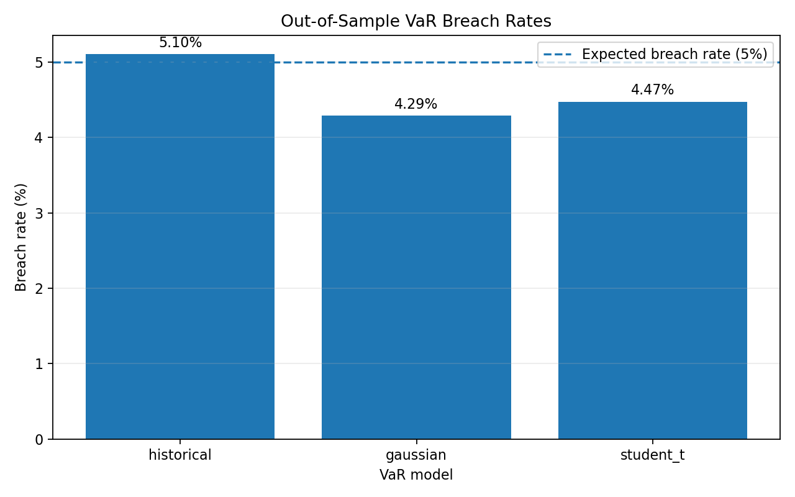
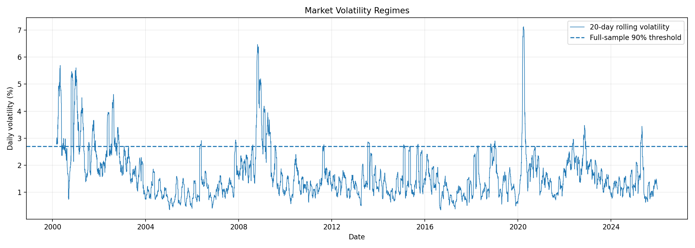
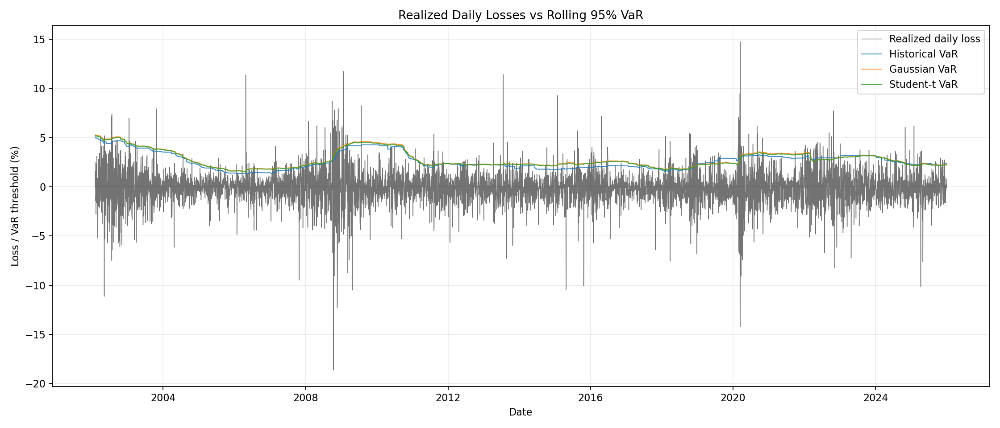

# When Does VaR Stop Working?
## A Diagnostic Framework for Market-Risk Model Failure

**Research area:** Quantitative Finance, Market Risk, Statistical Backtesting  
**Asset:** Microsoft (MSFT)  
**Sample period:** 2 February 2000 – 31 December 2025  
**Forecast horizon:** One trading observation  
**VaR confidence level:** 95%

---

## Abstract

This study compares historical simulation, Gaussian parametric, and Student-t Value at Risk (VaR) models using rolling out-of-sample forecasts derived from Microsoft daily closing prices. Each model uses a 500-observation rolling estimation window. Forecasts are evaluated through breach frequency, the Kupiec unconditional-coverage test, descriptive breach-clustering statistics, and comparisons between normal- and high-volatility regimes.

Across 6,017 forecasts per model, historical simulation produced a 5.10% breach rate, Gaussian VaR produced 4.29%, and Student-t VaR produced 4.47%. At the 5% significance level, the Kupiec test rejected the expected unconditional breach frequency for Gaussian VaR but did not reject it for the other two models. All three models showed higher breach rates in the retrospectively classified high-volatility regime.

These findings illustrate the importance of evaluating risk forecasts against realized losses and investigating performance across market conditions. They do not establish that any one model is universally superior.

## 1. Research Objective

Value at Risk estimates a loss threshold associated with a chosen confidence level and time horizon. At 95% confidence, a correctly calibrated model is expected to experience losses beyond its forecast threshold on approximately 5% of observations.

However, market returns can exhibit heavy tails, changing volatility, and clusters of extreme observations. These properties motivate empirical evaluation rather than reliance on a model's theoretical assumptions alone.

The study addresses four questions:

1. Do the three models achieve the expected unconditional breach frequency?
2. How do their breach rates differ across volatility regimes?
3. Do breaches appear in consecutive runs?
4. What limitations remain when evaluating VaR using breach frequency alone?

## 2. Data and Methodology

### 2.1 Data

The dataset contains 6,518 observations of Microsoft closing prices from 2 February 2000 through 31 December 2025. Daily simple returns are calculated as

\[
r_t=\frac{P_t-P_{t-1}}{P_{t-1}}.
\]

The resulting series contains 6,517 daily returns. The analysis uses a rolling window of 500 prior returns and evaluates the next return.

**Data limitation:** The source contains closing prices rather than adjusted closing prices. Stock splits and dividends may affect the calculated returns, so the results should be interpreted with this limitation in mind.

### 2.2 VaR Models

The study compares three models at the 95% confidence level.

**Historical simulation** estimates VaR from the empirical distribution of losses in the rolling window. It avoids a normality assumption but remains sensitive to the sample window and past market conditions.

**Gaussian VaR** assumes returns follow a normal distribution and estimates the mean and sample standard deviation in each window. It provides a parametric benchmark, but its assumptions may not fully represent extreme returns.

**Student-t VaR** fits a Student-t distribution to standardized returns and rescales it to match the sample mean and standard deviation. The heavier tails can represent more extreme observations than a Gaussian distribution, although this does not guarantee accurate forecasts under changing market conditions.

For all three models, the realized loss is \(L_t=-r_t\), and a breach occurs when

\[
L_t>\widehat{\operatorname{VaR}}_{0.95,t}.
\]

### 2.3 Backtesting

The empirical breach rate is

\[
\widehat{p}=\frac{\text{Number of breaches}}{\text{Number of forecasts}}.
\]

At 95% confidence, the expected breach probability is \(p_0=0.05\).

The Kupiec unconditional-coverage test evaluates whether the observed breach frequency is consistent with the target frequency. A p-value below 0.05 is treated as evidence against correct unconditional coverage at the 5% significance level.

The project also records descriptive breach-clustering measures. These help reveal whether breaches occur in consecutive runs, but they are not substitutes for a formal independence or conditional-coverage test.

### 2.4 Volatility Regimes

The analysis calculates 20-observation rolling standard deviation. Estimates above the 90th percentile of valid rolling-volatility estimates across the full sample are labelled high-volatility periods; the remaining valid observations are labelled normal-volatility periods.

This classification is retrospective because the threshold uses the full sample. It is useful for exploratory comparison but is not a real-time regime detector.

## 3. Results

### 3.1 Unconditional Coverage

| Model | Forecasts | Breaches | Observed rate | Expected rate | Kupiec p-value |
|---|---:|---:|---:|---:|---:|
| Historical VaR | 6,017 | 307 | 5.10% | 5.00% | 0.7169 |
| Gaussian VaR | 6,017 | 258 | 4.29% | 5.00% | 0.0094 |
| Student-t VaR | 6,017 | 269 | 4.47% | 5.00% | 0.0552 |

At the 5% significance level:

- **Historical VaR:** The Kupiec test does not reject the target unconditional breach frequency.
- **Gaussian VaR:** The test rejects the target frequency. The observed breach rate is below 5%, indicating fewer breaches than expected.
- **Student-t VaR:** The test does not reject the target frequency, although the p-value is close to the significance threshold.

The Gaussian result is evidence of a mismatch with the specified breach frequency; it does not mean that the model necessarily underestimates risk. Fewer breaches can be consistent with more conservative thresholds. The test alone does not evaluate the size of losses beyond VaR or the timing of breaches.

### 3.2 Volatility-Regime Comparison

| Regime | Historical VaR | Gaussian VaR | Student-t VaR |
|---|---:|---:|---:|
| High volatility | 13.29% | 12.35% | 12.82% |
| Normal volatility | 4.47% | 3.67% | 3.83% |

All three models have higher breach rates during high-volatility periods than during normal-volatility periods. This pattern supports examining risk-model performance across different market conditions rather than relying only on a single full-sample breach rate.

The regime definition is retrospective, so these results do not demonstrate that a real-time regime signal would have identified the same periods in advance. Further research should use thresholds determined only from past observations or independently defined stress events.

### 3.3 Forecasts Over Time

The forecast plot compares realized daily losses with the positive VaR thresholds from each model. It provides a visual means of identifying periods when realized losses exceed forecasts and of examining the relationship between market conditions and model thresholds.

Visual inspection is complementary to the statistical tests; it does not replace formal model validation.

### 3.4 Breach Clustering

The current implementation reports descriptive clustering measures, including the maximum number of consecutive breaches. These measures help characterize the temporal arrangement of exceptions.

However, the current results do not include a formal Christoffersen independence test. Therefore, the analysis does not establish statistically whether breaches are independent over time.

## 4. Discussion

The three models show different unconditional breach frequencies. Historical VaR is closest to the 5% target by absolute difference, and the Kupiec test does not reject its unconditional coverage. The Student-t result also does not reject the target at the 5% level, while the Gaussian result does.

The high-volatility comparison reveals a separate issue: breach rates rise for all three models during the retrospectively classified high-volatility regime. A satisfactory aggregate breach frequency can therefore coexist with weaker performance in particular market conditions.

The results must be interpreted cautiously. The analysis uses a single stock, unadjusted closing prices, a fixed rolling-window length, and a retrospective regime threshold. These design choices limit generalization to diversified portfolios, other assets, and live risk-management systems.

## 5. Limitations and Future Work

The following extensions would strengthen the study:

1. Replace closing prices with adjusted prices and validate the corporate-action treatment.
2. Extend the analysis to multiple assets or a portfolio.
3. Implement formal Christoffersen independence and conditional-coverage tests.
4. Compare 95% and 99% VaR forecasts.
5. Evaluate Expected Shortfall to study the severity of losses beyond VaR.
6. Develop a regime-detection threshold using only information available at each forecast date.
7. Examine sensitivity to estimation-window length and alternative distributional assumptions.

## 6. Conclusion

This study presents a reproducible framework for comparing three VaR models using rolling out-of-sample forecasts. The unconditional-coverage results differ across models, and all three exhibit elevated breach rates in the retrospectively identified high-volatility regime.

The main conclusion is methodological: VaR should be assessed by comparing forecasts with realized losses and examining how performance changes across market conditions. Breach frequency is an important diagnostic, but it is not a complete measure of risk-model quality.

---

*Results reported here correspond to the current project run. Recalculate the tables and figures if the dataset, model implementation, or configuration changes.*